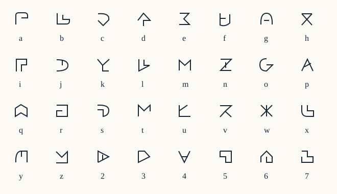

# Noema

**現在の優先目標（2026-09-29）:** 自動翻訳器の開発は保留し、言語本体を先に完成させる。未登録の名詞・抽象概念を説明で定義する仕組みを拡張し、アインシュタインとカントの作品をそれぞれ全文Noemaで記述する。[完成条件と検証対象](docs/language-completion.md)を現在の作業基準とする。以下の翻訳実験は過去の記録であり、現在の開発優先順位ではない。

[文語0.8の定義・一般量化](docs/spec-v08.md)を追加した。名詞・関係・関数を文書内で定義し、全称と存在の順序、引数の型、局所参照を検査できる。意味未説明の基本記号と、既存式から定義した語を区別する。モデルなしの解析・整形・固有文字・SVGに接続したが、基礎概念の確立や論文全文の記述は未完了である。

Noemaの初期実装。人が読み書きする形式言語と、凍結した多言語エンコーダーから意味を抽出する実験系を分離している。生成モデル、指示プロンプト、VQは使わない。逆方向は、既存15概念の単文を定型文にする限定実装である。

[未解決の必須課題](docs/open-problems.md)として、短文に対する文字数の膨張、通常のLLMが理解できる文への広い対応、辞書・ハードコードに依存しない翻訳を追加した。現行の定型文による逆変換は最終方式に適合せず、置換が必要である。非生成型・プロンプト不使用の制約は維持する。

[短縮記法](docs/compact-notation.md)では、版指定を2文字にし、主体・対象を語順で区別する。`e:ih mu si.` と従来形式は同じ意味構造に戻る。12例の全文字数は305→161となったが、短い日本語より長い問題と、人による読みやすさの検証は残る。

文語0.5では、[状態から変化の語を作る規則](docs/writing-v05.md)を追加した。「開いている」に共通の形態素を組み合わせ、「開く」「開ける」を構成する。13種類の状態に適用でき、派生語の個別登録は不要。[型・作用範囲・旧版との互換性](docs/spec-v05.md)を検査する。自然言語解析器の対応範囲が0.5全体に広がったことを意味しない。

文語0.6では、[複数対象の結合と再参照](docs/writing-v06.md)を追加した。`f:no fo w[mu][si]o pets. po p pets.` のように集合全体を指し、成員も別に参照できる。数量・名前・否定の範囲を保持し、集合を表せない旧版への変換は拒否する。[仕様](docs/spec-v06.md)に型と意味の制限を記した。自然言語からの自動抽出・逆変換は未対応で、共同／分配の指定は次の0.7で追加した。

文語0.7では、[集合全体への適用と、成員ごとの分配](docs/writing-v07.md)を明示できる。`g:w-w i[no w[mu][si] fo].` は犬と猫を共同の主体にし、`g:w-p a[w[mu][si]][po p a].` は各成員について眠ることを述べる。「各成員が眠らない」と「全員が眠るわけではない」の否定範囲も区別する。[仕様と検証](docs/spec-v07.md)に局所参照・型・旧版との互換性を記した。自然文からこの意味を抽出する解析と逆変換は未対応のままである。

[文字版2](docs/alphabet-v2.md)では、文法の働きが近い文字を共通の骨格から構成する。画面とCLIに新字形を接続し、旧字形の文章も引き続き読める。字形の似た組が増えるため、人が読みやすくなったかは未検証である。

[既存の語義モデルを追加学習せず使う比較](docs/bem-probe-results.md)も実装した。語彙ごとの分類器を作らず概念定義を候補にできるが、新しい日英資料では精度が不足し、本番採用を見送った。概念選択と文全体の意味構造一致は区別して測定している。

続く[共通の小型判定器](docs/shared-matcher-results.md)では、概念数に依存しない3係数と双線形射影を比較した。学習に使わない50概念で3係数方式は日本語66%・英語70%となったが、状態や関係の区別、未知判定は精度不足で、本番への接続には至っていない。

[既存の意味役割モデルの転用](docs/srl-transfer-results.md)では、語別の追加学習なしで原文から述語と項を予測する実験系を実装した。日英の出来事の分類は19組中15組で一致したが、項が助詞や前置詞に付く問題と、日本語の受動態などでの誤分類が残った。広い自然文を翻訳する部品として検証中で、主画面には接続していない。

続く[学習済みモデルによる句の抽出](docs/srl-span-results.md)では、前置詞を含む句全体を取得できた。指定した36範囲は日本語24件・英語35件が完全一致したが、日本語の受動態・従属節と語境界の整合性に問題が残る。これは部分条件の検査であり、全文の意味構造一致率ではない。

[語境界の整合性](docs/srl-boundary-results.md)を改善し、語の途中で句が始まらない共通の推定処理を追加した。日本語の指定範囲は既存資料で26/36、新しい8組で11/19になった。受動態や修飾節の役割の誤りは残り、広い自然文への翻訳は未完成である。

[日本語の学習済み解析器の転用](docs/japanese-pas-results.md)では、KWJAの分類器を生成・辞書補完なしで動かす部品を追加した。元の格・節関係は得られるが、受動態の意味役割への対応と、明示されない主体の推測を切り分ける必要がある。

[語彙クラスと独立した役割ヘッド](docs/role-transfer-results.md)も追加した。新しい動詞のために出力クラスを増やさず主体・対象等を判定できるが、未学習8述語群では検出漏れ込み31/42項にとどまった。受け手の誤分類と、格解析段階で候補から落ちる主体が課題である。

[文中の基本句へ候補を広げる処理](docs/role-candidates-results.md)で、旧評価・新評価とも42項すべてが候補に入った。ただし新評価の役割正解は31/42で、受け手・場所の誤りや、一つの事物が複数の基本句へ分かれる問題は残る。

[語句の範囲と役割を分けて学習する処理](docs/mention-scope-results.md)では、従来の評価で範囲と役割が39/42項一致した。一方、新しい複合語の評価では7/20項にとどまった。学習・開発資料に長い範囲が少なく、誤った範囲を役割判定で退ける学習条件も不足していた。一般の自然文へ対応できたとはせず、失敗を保存している。

[修飾を含む学習資料の追加と、範囲誤りを含めた役割学習](docs/mention-learning-v2-results.md)で、前回の複合語の範囲一致は7/20から18/20へ改善した。ただし新しい確認8文は範囲14/22、役割まで含めて10/22。正しい項の棄却、関係節の範囲、受け手・場所の誤りが残り、従来評価の役割一致には39/42から33/42への後退もある。

[語句の境界にある文脈表現を役割判定へ追加](docs/role-context-v3-results.md)し、語別の規則なしで、別の新規8文の一致を15/24から17/24へ改善した。既知48文で正しい項を捨てる件数も17→5になったが、関係節を含む範囲の欠落は残る。全文の意味構造一致や翻訳完成の条件を満たす結果ではない。

[範囲のラベル列全体を学習するCRF](docs/mention-sequence-v4-results.md)では、既知56文の範囲と役割の一致が119/150→138/150項になった。新規8文は従来・今回とも19/20項で、今回の全項一致は7/8文。重なる内側・外側の項を一つのBIO列で表せない制約が残るため、文全体への対応には出来事ごとの範囲と参照関係が必要である。

[出来事ごとに重なる項を抽出する構造](docs/multi-frame-v5-results.md)を実装し、新規8文の主節・修飾節を合わせた役割一致は25/38→33/38項になった。ただし正解の出来事に対応しない述語候補にも役割を付け、余分な役割が25件残った。全項一致は3/8文で、同一事物への参照統合と述語候補の判定は未解決である。

[出来事の候補を文脈から判定する共通ヘッド](docs/event-gate-v6-results.md)を追加し、新規12文では正しい16出来事を保持しながら不要な21候補を除外した。役割一致37/38を保ち、余分な役割は51→0件、全項一致は1/12→11/12文になった。同じ語を含む名詞と出来事はこの資料で区別できたが、参照・概念・否定等を含む全文のNoema変換は未完成である。

[設計の見直し](docs/design-review.md) では、利用者の指定により非生成型を今後も維持する。状態からの語形成と文法機能による字形分類を導入したが、基本語全体を意味から構成する設計と、分類器の語彙拡張は未解決である。元のコンセプトを実現済みとはしていない。

言語として使える段階に向けて開発を継続している。[開発目標](docs/development-goal.md) に必須条件を記載した。文語0.4は、[基本の文法](docs/writing-v03.md) の91概念と8種類の役割、複数文の参照、質問・依頼・条件・否定範囲に加え、[語を組み合わせる規則](docs/writing-v04.md) を持つ。「本＋赤い」などを辞書へ個別登録せずに書ける。[厳密な仕様](docs/spec-v04.md)、[語彙参照](docs/lexicon-v03.md)、[対訳読本](docs/readings.md)、[練習と解答](docs/lessons.md) を用意した。0.1〜0.3の文章も引き続き読める。

`parse`・`format`・`render` と文語の編集はモデルなしで動作する。自然言語の `analyze` と画面での自然言語からの変換は、学習済みの小型分類器を必要とする。**最新の対照実験v9は英語の確定率が51.00%で、採用基準未達となった。** [最新報告](docs/context-experiments.md) に失敗を含めて記録した。以前の [v7の限定した人工文評価](docs/surface-experiments.md) では、日本語の確定率96.50%・完全一致率97.75%、英語90.17%・100%で条件を通過したが、別の手書き回帰で代名詞など3文を誤確定した。自由記述全般への対応や、言語全体の完成を宣言する段階には至っていない。[以前の確認評価の失敗](docs/joint-experiments.md)、[関係分類器](docs/structured-experiments.md)、[線形・MLP](docs/experiments.md) の結果も保持している。

[固定モデルの依存関係・照応を使う参照統合](docs/reference-head-v1-results.md)を追加した。追加学習なしで、範囲抽出を含む参照分割が12文中8文で一致したが、「赤い本」と「青い本」の誤統合が残った。うち新規9文は5文一致で、全文意味構造の精度や広い自然文への対応を保証する結果ではない。

[公開文章の評価を訂正](docs/corpus-reference-v2-correction.md)した。旧処理はコーパスに注釈されていない主辞位置を正解としていたため、旧参照精度と参照判定器v1の学習・選択を撤回した。実際の基本句範囲で測り直すと、固定モデルの開発512文書での参照ペア適合率52.90%・再現率65.43%、基本句と参照の文書完全一致185/512件だった。評価単位の修正であり、精度改善とは扱わない。[原文位置の修正](docs/character-alignment-v1-results.md)による解析失敗4件の解消と、既存508文書の予測不変性は有効な検査として保持する。

[修正した基本句範囲で再学習した共通参照判定器v2](docs/reference-ranker-v2-results.md)は、以前に観察済みのtest700文書で参照ペアF1が66.57%→67.41%、基本句と参照の文書完全一致が159→160件だった。未知資料での独立評価ではなく、全文意味構造の一致率や翻訳完成の証拠にもならない。

[固定モデルの並列関係の抽出](docs/coordination-v1-results.md)を実装した。開発512文書で並列辺の適合率71.99%・再現率70.60%、基本句と辺集合の文書完全一致234/512件だった。追加学習・辞書補完はないが、誤検出と意味の未確定が残る。「両方」「どちらか」や成員範囲を構文だけでは確定できず、文語0.6の集合への自動変換には接続していない。

[予測した範囲・役割と91概念の定義照合を接続](docs/lexical-frames-v1-results.md)した。原文だけから処理し、語彙ごとの分類クラスは増やしていない。日本語18文では役割・範囲37/40項、概念も含めると32/40項、全フレーム一致5/18文だった。述語を関連する物体と取り違える誤りもあり、否定・時間等の未接続要素を含めた確定翻訳は0件である。

[概念と役割の同時選択](docs/joint-lexical-v2-results.md)を追加し、再学習や語別の補正なしで、型と役割の制約を満たすスコア最大の組合せを求めた。全フレーム一致は既存18文で5→12文、新規14文で4→6文に改善した。ただし、未知概念を型に合う既知概念へ誤対応させる問題や、必要な項の欠落は残る。全文の確定翻訳は引き続き0件で、研究用APIとして保持する。

[固定BGE-M3への交換](docs/bge-matcher-v1-results.md)も比較した。同じ資料で共通3係数だけを学習したが、新規24組で日本語14/24・英語13/24と既存方式を下回り、予測範囲を使う32文でも改善しなかった。モデル交換は採用せず、対象語と関連概念を区別する共通判定の不足を課題として残した。

[原文と定義の同時符号化](docs/paired-matcher-v1-results.md)も実装し、開発から91候補で共通ヘッドを比較した。選択した線形ヘッドは新規20組で各言語14/20だったが、日英とも正しい組は既存13→11組に減少した。部分的な改善と悪化が混在するため、研究用として保持し、少数概念に偏った教師資料と開発区分の見直しを次の課題とした。

[教師資料を52概念・開発19概念へ再編](docs/broad-matcher-v1-results.md)し、言語と概念ごとの損失を均等化した。新しい留保19概念の文では日本語11/19・英語13/19で、既存方式を下回った。少数例の再編では改善を確認できず、この設定も研究用に保持する。過去の確認資料を学習へ移した履歴と、概念・原文の区分を記録した。

[公開語義注釈WiC-TSVの読込みと共通二値判定](docs/wic-verifier-v1-results.md)を実装した。英語2,828学習例・389開発例を元の位置・ライセンスとともに監査し、Noema例を加えず学習したが、Noemaへの転用では候補が「職場」に偏った。判定器は不採用とし、同じ対象の正負定義を比較できる446学習グループを次の検査対象として記録した。

[正負定義の順位学習](docs/contrastive-verifier-v1-results.md)も比較した。原文・見出し語を共有しない内部区分で線形・MLPの対照を揃えたが、選ばれた方式のNoema概念正解は日本語12/179・英語7/179で、未知例にも全件で肯定候補が出た。候補の偏りは変わっても転用失敗は解消せず、不採用とした。4条件の再学習・全予測の一致と全436テストの通過を確認した。

[既存の関連度分類器を追加学習なしで使う照合](docs/pretrained-reranker-v1-results.md)を実装した。固定BGE rerankerへ対象だけを入力すると日本語15/19・英語10/19、全文では8/19・11/19で、関連する物体や場所を出来事と取り違える誤りが残った。生成や語別学習は不要だったが、意味一致の精度が不足するため採用していない。全439テストと、実モデルの反復・保存スコアからの再集計を確認した。

[対象を伏せる前後の関連度差](docs/target-ablation-v1-results.md)も検証した。同じ文で対象を切り替える新資料では、差分による概念正解は日本語9/17・英語11/17で、対象だけの入力を上回らなかった。候補が変わることと両対象の正解を区別する評価器を追加し、全443テストと再現検査を通した。翻訳器へは採用していない。

[語義照合を学習済みのGlossReader](docs/glossreader-v1-results.md)を追加学習なしで検証した。91概念からの選択は日本語92/196・英語95/196で既存MiniLMを下回り、不採用とした。日本語で対象位置を別々にトークン化して数える際のずれを検出し、原文の文字オフセットを使う実装を保存した。全446テストと実モデルの反復・保存特徴からの再集計を確認したが、広い自然文の翻訳は未完成である。

[定義ベクトルの長さと共通方向を切り分ける診断](docs/gloss-geometry-v1-results.md)では、共通方向を1本除くと概念正解は日英とも103/196になった。ただし既存方式を下回り、犬・猫・追う出来事の取り違えも残る。数値補正だけでは解消せず、研究用の比較処理として保持した。全450テストと4方式の保存特徴からの再計算が通過した。

## 実行

Python 3.11以上。リポジトリのルートで実行する。

```powershell
python -m pip install -e ".[test]"
python -m noema edit
```

ブラウザーで `http://127.0.0.1:8765` を開くと、日本語／英語とNoemaの2入力欄があるダークモードの変換画面を使える。自然言語からの変換には学習済みの分類器が必要で、この環境では保存済みのv7を使う。別のチェックポイントは `python -m noema edit --checkpoint <path>` で指定する。逆方向は15概念の単文を定型文にする処理で、未対応の構造は内容を省かず拒否する。

同じポートでの二重起動はエラーで停止する。Windowsではポートの再利用設定によって複数のサーバーへ接続が分かれるため、排他的に起動する。[Microsoftのソケット仕様](https://learn.microsoft.com/en-us/windows/win32/winsock/using-so-reuseaddr-and-so-exclusiveaddruse)に従い、古い実装へ接続される問題を防ぐ。

従来の編集機能は `/writing` にある。文法検査、固有文字への切替、語彙検索、文章・意味JSON・SVGの保存ができる。「文章を開く」で64 KiB以下のUTF-8文書を読み込み、「開く前に戻す」で直前の文章に戻せる。終了はターミナルでCtrl+C。CLIで扱う場合は次を使う。

「複合語を作る」で対象と性質を選んで挿入できる。「読み書きを試す」では18問に回答し、意味の一致と固有文字の読み方を確認できる。[利用者確認の方法](docs/usability.md) に、実際の利用者の結果と自動テストの区別を記載した。

```powershell
python -m noema parse --input examples/school.noema
python -m noema render --input examples/school.noema --output artifacts/school.svg
python -m noema parse --input examples/chase.noema
python -m noema format --input examples/chase.json
python -m noema render --input examples/chase.noema --output artifacts/chase.svg
python -m noema alphabet --output artifacts/alphabet.svg
python -m pytest -q
```

入力は `--text`、UTF-8ファイルの `--input`、標準入力のいずれかで渡す。`--output` を省略すると標準出力に書く。正常終了は0、文法違反・入出力エラーなどは2。`analyze` の未確定・未対応は正常な解析状態なので終了コード0となる。

「犬が猫を追う」は現在の文語では次のように書く。`ih` が追う、`mu` が犬、`si` が猫、`i` が主体、`j` が対象である。

```text
noema d d
ih i mu j si.
```

同じ意味の旧0.1形式も保存している。`aa` は犬、`ab` は猫、`ba` は追う出来事の概念IDを表す。

```text
noema a a {
  ev e ba pos unspec;
  en na aa ? ?;
  en nb ab ? ?;
  agent e na;
  patient e nb;
  recipient e ?;
  location e ?;
}
```

`?` は未指定。犬の数量を1と推定したり、受け手や場所を補ったりしない。節と宣言の順序、参照名は変えて書ける。正規化すると一定の順序・参照名になる。[文法と意味構造](docs/language.md) に語彙、数量、固有名、時間、参照の規則を記載した。



[学校での本のSVG表示](examples/school.svg) と [固有アルファベット・フォント](docs/alphabet.md) を参照。0.1の文章表示は旧字形を保持する。新字形の32文字の描画とフォントの生成は検査済みで、読みやすさの利用者評価は未実施。発音体系は文語を優先する今回の対象に含めない。

## 自然言語の解析と実験

確認評価を通ったv7の実行方法と検証範囲は [実験報告](docs/surface-experiments.md) に記載した。その後の [v8](docs/reference-experiments.md) と [v9の対照実験](docs/context-experiments.md) は、英語の確定率が約半分に下がり、不合格となった。v9の新規確認は日本語91.67%・99.64%、英語51.00%・100%で、未対応区分にも誤確定が残る。この作業環境では、以前の限定した確認条件を通ったv7を次のコマンドで実行できる。重みはGit管理外のローカル成果物なので、別の環境では先に再現手順で学習する。

```powershell
python -m noema analyze --language ja --text "犬が猫を追う" --checkpoint artifacts/routed-v7 --offline
```

以下は比較のために保持した旧ベースラインの実行方法である。

```powershell
python -m pip install -e ".[ml,test]"
python -m noema dataset
python -m scripts.run_experiments
python -m noema analyze --language ja --text "犬が猫を追う" --checkpoint artifacts/xlmr-linear-100 --offline
python -m scripts.verify_checkpoint artifacts/xlmr-linear-100 --output artifacts/challenge.json --offline
```

初回は公開モデルをHugging Faceの標準キャッシュへダウンロードする。認証トークンは不要。`scripts.run_experiments` はXLM-RとMiniLMそれぞれで、線形ヘッドの学習量25%・100%、浅いMLPの100%を比較する。モデルの重みは変更せず、特徴量を保存してから分類器だけを学習する。処理済みの実験は再利用し、明示的な `--rerun` で派生成果物を置き換える。

段階別に実行する場合は次を使う。

```powershell
python -m noema features --model xlmr --output artifacts/xlmr-features.pt
python -m noema train --features artifacts/xlmr-features.pt --architecture linear --output artifacts/xlmr-linear-100
```

`--device cuda` は特徴量抽出と解析で指定できる。今回の実測環境はCPU版PyTorchであり、GPU間・CPU/GPU間の一致は検証していない。実行環境、モデルとトークナイザーの固定コミット、精度、学習条件、データと重みのハッシュは各チェックポイントの `metadata.json` に残す。

`analyze` の戻り値は `status`、`graph`、`diagnostics`。`confirmed` のときだけ意味構造を返す。確信度、原文の文字範囲、モデル情報は `diagnostics` に置き、Noemaの意味本体へ混ぜない。チェックポイントがなければ `checkpoint_required` として未確定を返し、推測で翻訳しない。

## ファイル

| 場所 | 内容 |
|---|---|
| `noema/semantics.py`, `grammar.py` | 型・参照検査、正規化、厳密な構文解析 |
| `noema/resources/lexicon.json` | 永続的な概念識別子と定義、語彙版 |
| `noema/render.py` | 32基本文字とSVG出力 |
| `noema/encoder.py`, `model.py`, `training.py` | 凍結エンコーダー、小型ヘッド、学習・評価 |
| `noema/dataset.py`, `data/challenge.jsonl` | 再生成可能な注釈資料と手書きの検証例 |
| `reports/` | 実測値、環境情報、失敗の内訳 |
| `artifacts/` | ローカルの特徴量・分類器・詳細予測。Git管理外 |

基準モデルの根拠と実装方法は [XLM-Rモデル説明](https://huggingface.co/FacebookAI/xlm-roberta-base)、[MiniLMモデル説明](https://huggingface.co/sentence-transformers/paraphrase-multilingual-MiniLM-L12-v2)、[Transformers Auto classes](https://huggingface.co/docs/transformers/model_doc/auto) を参照。旧構想の `concept.md` は参考資料としてそのまま残し、現行仕様はこのREADMEと `docs/` に分離した。
