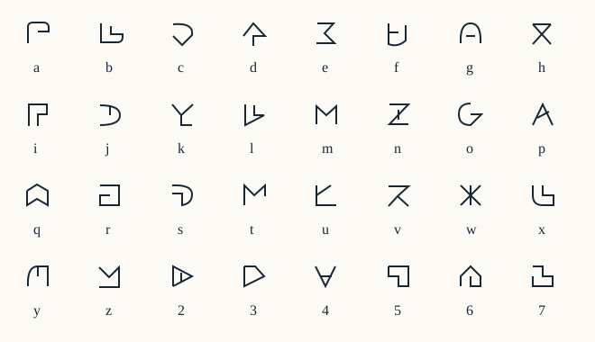

# 固有アルファベット

Noemaの文語用に32字を定め、SVGとTrueTypeフォントを同じ字形データから生成する。各文字は大きさや位置の違う点だけに依存せず、骨格そのものを変えた。発音は今回の必須仕様に含めない。



図の下にある `a–z, 2–7` は入力・説明用の代用文字。固有文字そのものの名前や発音ではない。独立した文字は32個で、概念語はそれらの組合せから作る。左から右へ横書きし、語の間を空白で区切る。句点 `.`、角括弧 `[ ]`、未指定の `?`、引用符は構造記号として別に扱う。

## 固有文字で保存する

```powershell
python -m noema script --input examples/discourse.noema --output artifacts/written.txt
python -m noema parse --input artifacts/written.txt
python -m noema script --decode --input artifacts/written.txt
```

固有文字のテキスト表現にはUnicode私用領域のU+E000〜U+E01Fを割り当てる。これはNoema内の符号化規約で、Unicodeによる文字体系の登録ではない。コードポイントと代用文字の対応は一対一で固定する。通常の `parse` もこの表現を受け取れる。引用した固有名や日付は変換せず、元のUnicode表記を保持する。

フォントは [NoemaWritten.ttf](../noema/resources/NoemaWritten.ttf)。このフォントを指定できるアプリケーションで私用領域の文章を表示できる。フォントのない環境では文字が表示されない場合があるため、共有時にはSVG表示か、代用文字の文章も併記する。`render` はフォントを外部参照せず、SVG内に字形を含める。

現在の字形は0.2と0.3の文書の表示に使う。0.1文書のSVG表示は旧試作の形を保持する。文法版・概念IDと書体は別の層であり、字形を改良しても文書の意味は変えない。

## 字形の原本と再生成

原本は `noema/resources/alphabet-v1.json` の32本のパス。描画の線幅、字面、私用領域の開始位置も同じファイルに置く。フォントはこのパスを輪郭にして生成する。時刻を固定し、同じ原本とビルド環境から同じバイト列を得られるようにした。

```powershell
python -m pip install -e ".[font]"
python -m scripts.build_font
python -m noema alphabet --output examples/alphabet.svg
```

フォントの全32字を実際にラスタライズして、欠字がなく、画像がそれぞれ異なることを確認している。最も似た組合せも [検査記録](../reports/alphabet-proof.json) に残す。ただし画素の一致率は人間の読みやすさの代用にはならない。似た字の読み違い、手書き時の混同、小さい文字での識別は、学習資料を使った利用者評価が残っている。
