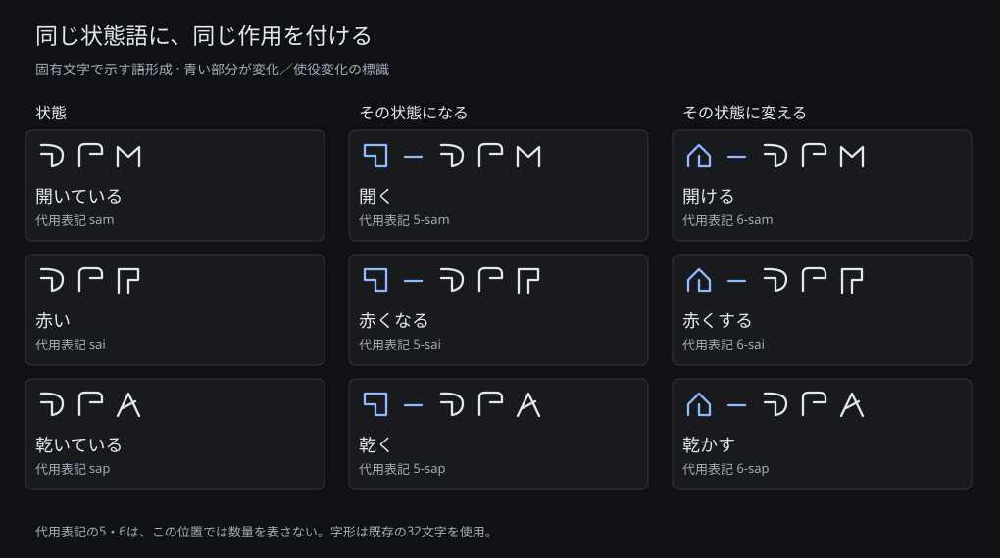

# 状態を覚え、変化の語を組み立てる

「赤い」「赤くなる」「赤くする」を、共通する部分から書けるようにする。文語0.5では状態語の前に二つの標識を使い分ける。状態語ごとに変化の語を登録する必要はない。

| 状態の語 | その状態になる | その状態に変える |
|---|---|---|
| `sam` 開いている | `5-sam` 開く | `6-sam` 開ける |
| `san` 閉じている | `5-san` 閉じる | `6-san` 閉める |
| `sai` 赤い | `5-sai` 赤くなる | `6-sai` 赤くする |
| `sao` 濡れている | `5-sao` 濡れる | `6-sao` 濡らす |
| `sap` 乾いている | `5-sap` 乾く | `6-sap` 乾かす |

日本語の短い訳は読み方の手掛かりである。例えば `6-sap` は、乾いた状態に変えたことを述べる。「乾かそうとしたが濡れたままだった」という試みは含まない。正確な作用範囲と型は[仕様](spec-v05.md)で定める。



## 三つの文を書く

`maj` はドア、`fo` は子供を表す。文書の先頭に `noema e e` を置き、次のように書く。

```noema
noema e e
sam i maj.
5-sam i maj.
6-sam i fo j maj.
```

順に「ドアが開いた状態にある」「ドアが開く」「子供がドアを開ける」。`i` の対象は、二つ目では変化するドア、三つ目では変化を起こす子供になる。三つ目のドアは `j` で指定する。それぞれの名詞は別々に導入されており、この3文だけでは同じドアだと指定していない。

同じ対象について文を連ねるなら、参照を付ける。次の文は「昨日はドアが開いていた。今日、葵がそのドアを閉めた。今、そのドアは閉じている」と述べる。

```noema
noema e e
r sam i maj o door.
s 6-san i qo n "葵" j p door.
f san i p door.
```

最後の状態は独立した断定として明記している。一度閉めたから現在も閉じている、という補完はしない。`door` はこの文章内で自由に選んだ参照名で、ドアという基本語の代わりではない。`o a` と `p a` にそろえて書き換えてもよい。

## 否定と省略を区別する

```noema
noema e e
u [ 5-sam i maj ].
u [ sam i maj ].
6-sam j maj.
```

一つ目は開く変化の否定、二つ目は開いた状態の否定である。三つ目はドアを開ける出来事の主体を未指定にする。省略された主体を特定の人として補わない。

## 自分で組み立てる

`sai` は赤い、`jx` は本、`mae` は果物を表す。次の文を、ここに掲載していない組合せで書いてみる。

1. 果物が赤くなる。
2. 子供が本を赤くする。
3. 子供が本を赤くすることを否定する。
4. 誰がドアを開けるのか質問する。

解答例：

```noema
noema e e
5-sai i mae.
6-sai i fo j jx.
u [ 6-sai i fo j jx ].
b 6-sam i c j maj.
```

[文語編集画面](http://127.0.0.1:8765/writing)へ入力するか、CLIの `parse`・`format`・`render`・`script` で検査できる。これは文語の練習であり、自然言語の解析器へこれらの文を入力して正解することを保証するものではない。

この拡張は語の構成に意味の規則を与える。32基本字形そのものの体系的な再設計や、人による識別性の検証はまだ完了していない。
